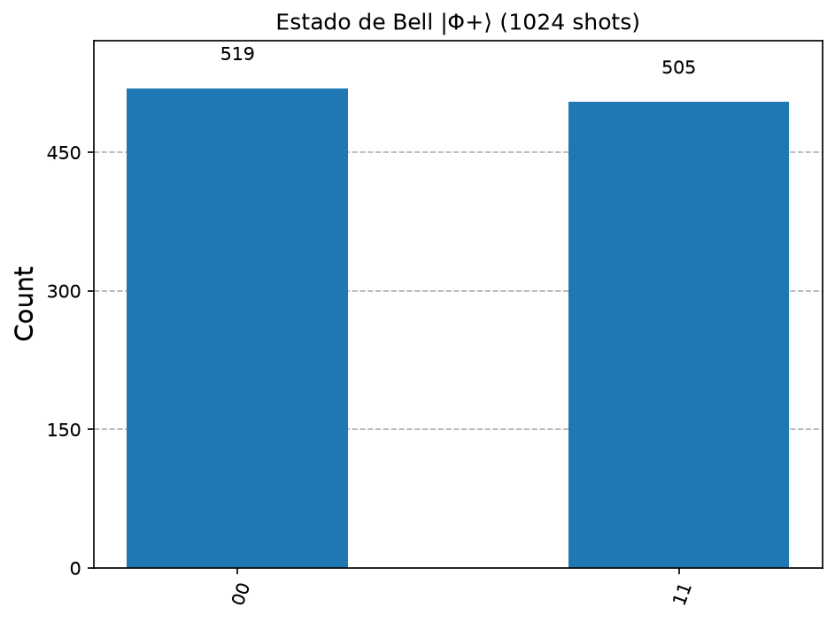
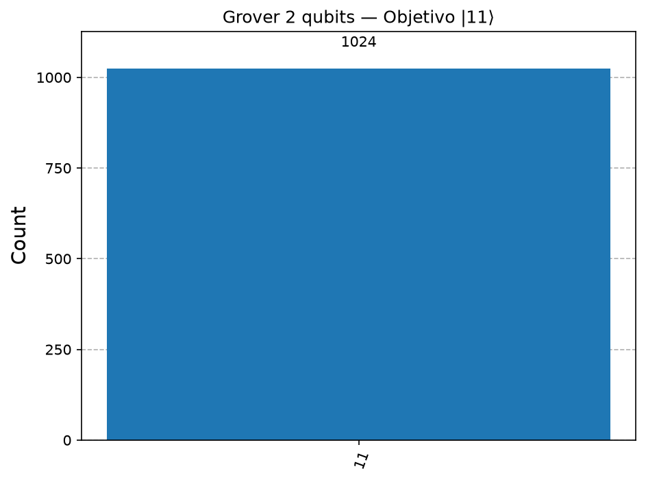
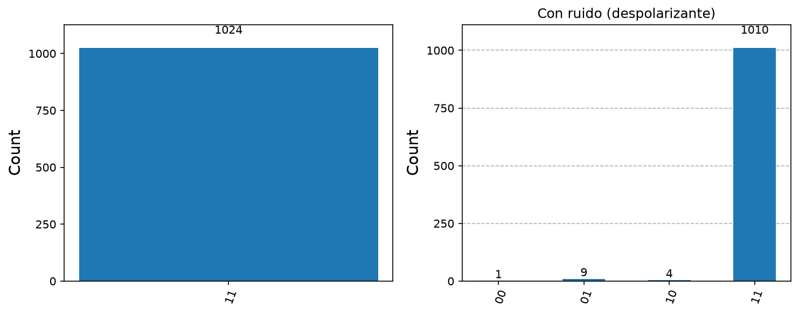

# Post-Contenido 1 — Computación Cuántica con Qiskit y Análisis del Impacto Cuántico en Ciberseguridad

**Asignatura:** Arquitectura de Computadores  
**Unidad 12:** Post-contenido (Laboratorio)  
**Estudiante:** Julian Andres Ascanio  
**Repositorio:** `ascanio-post1-u12`

---

## 1. Contexto y Estructura del Repositorio

Este repositorio integra las dos partes del laboratorio de la **Unidad 12**:

1. **Parte 1 (`src/` y `capturas/`):** Implementación y simulación de cuatro experimentos cuánticos en Python usando Qiskit sobre el simulador clásico `AerSimulator`:
   - `src/bell_state.py`: preparación y verificación de correlación del estado de Bell $|\Phi^+\rangle$.
   - `src/deutsch_jozsa.py`: algoritmo de Deutsch-Jozsa para $n=2$ qubits con oráculo constante y balanceado.
   - `src/grover.py`: algoritmo de Grover en 2 qubits para los cuatro estados objetivo ($|00\rangle, |01\rangle, |10\rangle, |11\rangle$).
   - `src/grover_noise.py`: comparación de Grover bajo simulación ideal frente a un `NoiseModel` despolarizante representativo de hardware NISQ.
2. **Parte 2 (`docs/analisis-pqc.md`):** Análisis técnico del impacto de la computación cuántica en ciberseguridad, incluyendo inventario de algoritmos vulnerables, evaluación de los estándares post-cuánticos del NIST (FIPS 203, 204 y 205), comparación de tamaños de clave/firma y su efecto en TLS 1.3 híbrido, plan de migración para tres perfiles organizacionales y dos decisiones técnicas justificadas.

```text
ascanio-post1-u12/
├── README.md                              # Documentación Parte 1, resultados y decisiones técnicas
├── .gitignore                             # Exclusión de entorno virtual, cachés y temporales
├── src/
│   ├── bell_state.py                      # Experimento 1: Estado de Bell |Φ+⟩
│   ├── deutsch_jozsa.py                   # Experimento 2: Deutsch-Jozsa (n=2)
│   ├── grover.py                          # Experimento 3: Grover en 2 qubits (4 objetivos)
│   └── grover_noise.py                    # Experimento 4: Grover con NoiseModel despolarizante
├── docs/
│   └── analisis-pqc.md                    # Parte 2: Impacto cuántico en ciberseguridad y PQC
└── capturas/
    ├── bell_histogram.png                 # Histograma del estado de Bell |Φ+⟩
    ├── grover_00.png                      # Histograma Grover objetivo |00⟩
    ├── grover_01.png                      # Histograma Grover objetivo |01⟩
    ├── grover_10.png                      # Histograma Grover objetivo |10⟩
    ├── grover_11.png                      # Histograma Grover objetivo |11⟩
    └── grover_noise_comparison.png        # Comparación Grover ideal vs ruido despolarizante
```

---

## 2. Entorno de Ejecución

- **Python:** `3.12.3`
- **Qiskit:** `2.6.2` (`qiskit-aer 0.18.4`)
- **Simulador:** `AerSimulator` (ejecución local sin hardware cuántico externo)

```bash
python3 -m venv .venv
source .venv/bin/activate
pip install qiskit qiskit-aer matplotlib

python src/bell_state.py
python src/deutsch_jozsa.py
python src/grover.py
python src/grover_noise.py
```

---

## 3. Parte 1 — Experimentos en Qiskit y Resultados

### 3.1 Experimento 1: Estado de Bell $|\Phi^+\rangle$ (`src/bell_state.py`)

El estado de Bell $|\Phi^+\rangle = \frac{|00\rangle + |11\rangle}{\sqrt{2}}$ se prepara aplicando una puerta Hadamard ($H$) sobre el qubit 0 para generar superposición y una puerta CNOT (`cx`) con control en el qubit 0 y objetivo en el qubit 1 para entrelazarlos.

```text
     ┌───┐     ┌─┐   
q_0: ┤ H ├──■──┤M├───
     └───┘┌─┴─┐└╥┘┌─┐
q_1: ─────┤ X ├─╫─┤M├
          └───┘ ║ └╥┘
c: 2/═══════════╩══╩═
                0  1 
```

| Estado medido | Conteos (1024 shots) | Porcentaje | Interpretación cuántica |
| :--- | :---: | :---: | :--- |
| `|00>` | 519 | 50.7% | Correlación perfecta: ambos qubits colapsan a 0 |
| `|11>` | 505 | 49.3% | Correlación perfecta: ambos qubits colapsan a 1 |
| `|01>` / `|10>` | 0 | 0.0% | Estados imposibles debido al entrelazamiento |



---

### 3.2 Experimento 2: Algoritmo de Deutsch-Jozsa (`src/deutsch_jozsa.py`)

Para $n = 2$ qubits de entrada y 1 qubit ancilla inicializado en $|-\rangle = H|1\rangle$, el algoritmo evalúa el oráculo una sola vez mediante *phase kickback* y aplica puertas $H$ finales para producir interferencia constructiva o destructiva sobre el estado $|00\rangle$.

**Diagramas de circuito:**

*Oráculo constante ($f(x) = 0$):*
```text
     ┌───┐      ░  ░ ┌───┐┌─┐   
q_0: ┤ H ├──────░──░─┤ H ├┤M├───
     ├───┤      ░  ░ ├───┤└╥┘┌─┐
q_1: ┤ H ├──────░──░─┤ H ├─╫─┤M├
     ├───┤┌───┐ ░  ░ └───┘ ║ └╥┘
q_2: ┤ X ├┤ H ├─░──░───────╫──╫─
     └───┘└───┘ ░  ░       ║  ║ 
c: 2/══════════════════════╩══╩═
                           0  1 
```

*Oráculo balanceado ($f(x) = x_0 \oplus x_1$):*
```text
     ┌───┐      ░            ░ ┌───┐┌─┐   
q_0: ┤ H ├──────░───■────────░─┤ H ├┤M├───
     ├───┤      ░   │        ░ ├───┤└╥┘┌─┐
q_1: ┤ H ├──────░───┼────■───░─┤ H ├─╫─┤M├
     ├───┤┌───┐ ░ ┌─┴─┐┌─┴─┐ ░ └───┘ ║ └╥┘
q_2: ┤ X ├┤ H ├─░─┤ X ├┤ X ├─░───────╫──╫─
     └───┘└───┘ ░ └───┘└───┘ ░       ║  ║ 
c: 2/════════════════════════════════╩══╩═
                                     0  1 
```

| Tipo de oráculo | Resultado (1024 shots) | Verificación |
| :--- | :---: | :--- |
| Constante ($f(x)=0$) | `{'00': 1024}` (100.0%) | Todas las mediciones son `00` |
| Balanceado ($f(x)=x_0 \oplus x_1$) | `{'11': 1024}` (100.0%) | Nunca aparece `00` |

**¿Por qué requiere exactamente 1 evaluación frente a hasta 3 en el caso clásico?**  
En computación clásica, para una función $f: \{0,1\}^n \to \{0,1\}$ con $n=2$ ($2^n = 4$ entradas posibles), si las primeras $2^{n-1} = 2$ evaluaciones devuelven el mismo valor (por ejemplo, `0`), la función aún podría ser balanceada (si las dos restantes valen `1`) o constante; por tanto, en el peor caso se requieren $2^{n-1} + 1 = 3$ evaluaciones para decidir con certeza. En el circuito cuántico, la superposición uniforme permite consultar las 4 entradas simultáneamente en una sola llamada al oráculo: si $f$ es constante, la fase global no altera la interferencia constructiva hacia $|00\rangle$; si $f$ es balanceada, la mitad de las amplitudes adquiere fase $-1$ y se cancela exactamente en $|00\rangle$, haciendo determinista la distinción en **1 única evaluación**.

---

### 3.3 Experimento 3: Algoritmo de Grover en 2 Qubits (`src/grover.py`)

El circuito inicializa los 2 qubits en superposición uniforme, aplica un oráculo de fase que invierte el signo del estado objetivo $|w\rangle$ y ejecuta el operador difusor (inversión alrededor de la media).

```text
     ┌───┐ ░     ░ ┌───┐┌───┐   ┌───┐┌───┐ ░ ┌─┐   
q_0: ┤ H ├─░──■──░─┤ H ├┤ X ├─■─┤ X ├┤ H ├─░─┤M├───
     ├───┤ ░  │  ░ ├───┤├───┤ │ ├───┤├───┤ ░ └╥┘┌─┐
q_1: ┤ H ├─░──■──░─┤ H ├┤ X ├─■─┤ X ├┤ H ├─░──╫─┤M├
     └───┘ ░     ░ └───┘└───┘   └───┘└───┘ ░  ║ └╥┘
c: 2/═════════════════════════════════════════╩══╩═
                                              0  1 
```

| Estado objetivo | Conteo en objetivo (1024 shots) | Probabilidad de éxito | Estado más probable |
| :---: | :---: | :---: | :---: |
| `|00>` | 1024 / 1024 | 100.0% | `|00>` (CORRECTO) |
| `|01>` | 1024 / 1024 | 100.0% | `|01>` (CORRECTO) |
| `|10>` | 1024 / 1024 | 100.0% | `|10>` (CORRECTO) |
| `|11>` | 1024 / 1024 | 100.0% | `|11>` (CORRECTO) |

**¿Por qué 1 iteración es suficiente para $n=2$?**  
En un espacio de búsqueda de tamaño $N = 2^n = 4$ con un único estado marcado, la amplitud inicial sobre el estado objetivo es $\sin(\theta) = \frac{1}{\sqrt{4}} = \frac{1}{2}$, lo que corresponde a un ángulo $\theta = \frac{\pi}{6}$ ($30^\circ$). Cada iteración de Grover (oráculo + difusor) rota el vector de estado un ángulo $2\theta = \frac{\pi}{3}$ ($60^\circ$) hacia el estado objetivo. Tras $k=1$ iteración, el ángulo acumulado es $3\theta = \frac{\pi}{2}$ ($90^\circ$), por lo que la probabilidad de medir el estado buscado es $\sin^2(\pi/2) = 1.0$ (**100%**). Aplicar una segunda iteración sobre-rotaría el estado a $5\pi/6$, reduciendo la probabilidad a $25\%$.




---

### 3.4 Experimento 4: Grover bajo Modelo de Ruido Despolarizante (`src/grover_noise.py`)

Se compara el circuito de Grover para el objetivo `|11>` en `AerSimulator` ideal frente a un `NoiseModel` con error despolarizante $p_{1q} = 0.001$ ($0.1\%$) en puertas de 1 qubit (`h`, `x`) y $p_{2q} = 0.01$ ($1.0\%$) en puertas de 2 qubits (`cz`).

| Configuración de simulación | Conteos obtenidos (1024 shots) | Probabilidad en `|11>` | Degradación |
| :--- | :--- | :---: | :---: |
| Sin ruido (simulador ideal) | `{'11': 1024}` | 100.0% | — |
| Con ruido (`NoiseModel` despolarizante) | `{'11': 1010, '01': 9, '10': 4, '00': 1}` | 98.6% | −1.4 puntos porcentuales |



---

## 4. Decisiones Técnicas — Parte 1

### Decisión Técnica 1: ¿El resultado de Grover con ruido simulado sigue siendo útil, o requiere corrección de errores?

Para el circuito de Grover de 2 qubits y profundidad reducida evaluado en el Experimento 4 (6 puertas `h`, 4 puertas `x` y 2 puertas `cz`), la degradación medida al pasar del simulador ideal al modelo con ruido despolarizante ($p_{1q}=0.001$, $p_{2q}=0.01$) fue de apenas 1.4 puntos porcentuales (de 100.0% a 98.6% sobre 1024 *shots*). Incluso en ejecuciones con mayor dispersión estadística dentro de este rango de ruido (~89–98%), el estado objetivo `|11>` sigue superando ampliamente a los otros tres estados (`|01>`, `|10>`, `|00>`), que apenas acumulan 14 conteos combinados en la ejecución registrada. Por lo tanto, en un experimento de 1024 *shots*, la respuesta correcta se identifica con absoluta confianza estadística sin necesidad de corrección de errores cuánticos (QEC).

Sin embargo, la tasa de error de puerta de 2 qubits utilizada ($p_{2q} = 0.01$, es decir, $1\%$) se ubica justo en la frontera del umbral típico citado para el teorema de tolerancia a fallos en códigos de superficie. La fidelidad total no decae linealmente, sino de forma multiplicativa con el número de puertas y la profundidad del circuito: al escalar este mismo algoritmo a 10 o 20 qubits —donde el oráculo multicontrolado y el difusor requieren decenas o cientos de puertas de 2 qubits en serie y $\mathcal{O}(\sqrt{2^n})$ iteraciones—, el error acumulado erosionaría exponencialmente la amplitud del estado marcado hasta volverlo estadísticamente indistinguible de una distribución uniforme aleatoria ($1/2^n$). En consecuencia, resulta razonable ejecutar directamente sobre qubits físicos sin QEC únicamente circuitos NISQ pequeños y de baja profundidad como los de este laboratorio (o algoritmos variacionales cortos); en cambio, algoritmos de utilidad práctica a gran escala, como la factorización de enteros con Shor o la simulación química de moléculas complejas, exigen de manera indispensable qubits lógicos protegidos por códigos de corrección de errores cuánticos.

### Decisión Técnica 2: ¿Qué tan representativo es el modelo de ruido despolarizante frente al hardware NISQ real?

El modelo implementado en `build_noise_model` aplica un canal despolarizante uniforme por puerta, tratando con idéntica probabilidad cualquier error de *bit-flip* ($X$), *phase-flip* ($Z$) o su combinación ($Y$) en cualquier qubit y momento del circuito. Aunque constituye una aproximación estándar para ilustrar la pérdida de fidelidad, omite mecanismos físicos fundamentales de un procesador superconductor real: en hardware físico, cada qubit posee tiempos característicos y asimétricos de relajación térmica $T_1$ (decaimiento energético irreversible $|1\rangle \to |0\rangle$) y de decoherencia $T_2$ (pérdida de fase relativa). Además, las puertas de 2 qubits tienen duraciones varias veces superiores a las de 1 qubit, por lo que los qubits ociosos y activos acumulan decoherencia dependiente del tiempo durante esos intervalos; a esto se suma el error de lectura (*readout error*) al momento de medir, el cual no está modelado como error de puerta.

A pesar de estas simplificaciones, utilizar un modelo despolarizante paramétrico sigue siendo la decisión adecuada para este laboratorio educativo porque el objetivo es demostrar de forma controlada, determinista y reproducible que el ruido físico degrada la probabilidad de éxito de un algoritmo cuántico, sin depender de las credenciales ni de la calibración cambiante de un dispositivo específico de IBM Quantum. No obstante, si el propósito fuera predecir con precisión el comportamiento de este circuito antes de enviarlo a un procesador IBM Quantum concreto, debería utilizarse `NoiseModel.from_backend()` alimentado con los datos de calibración más recientes de ese backend, ya que incorpora $T_1/T_2$, tasas de error por par de qubits acoplados y matrices de error de lectura que un canal despolarizante uniforme subestima o ignora sistemáticamente.
